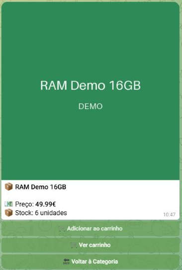
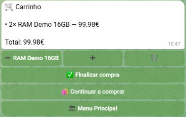
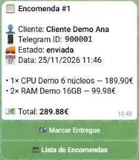
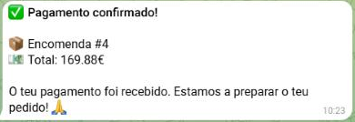
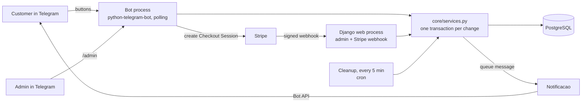
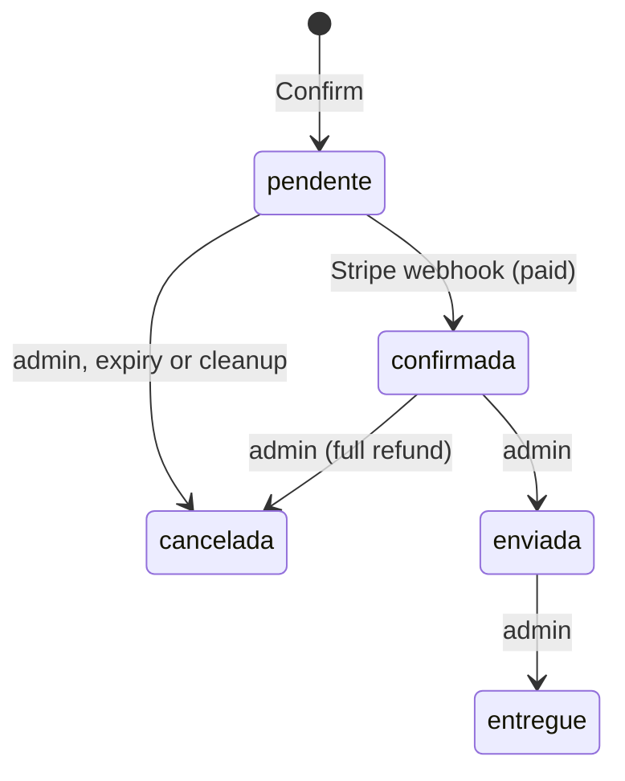

# Telegram Sales and Inventory Bot

A Telegram shop with a multi-product cart, stock control and Stripe Checkout payments, run from Django and PostgreSQL. Customers browse, fill a cart and pay inside Telegram; admins ship, cancel, refund and adjust stock from a Telegram admin panel; the shop owner manages the catalogue in Django admin. Each copy serves one shop and is configured without code changes.

The bot speaks European Portuguese. It is a portfolio project: it has run end to end in Stripe test mode, but no copy has been deployed for a real shop (see [Status](#status)).

## Screenshots

Demo shop, Telegram Web. Product photos are placeholders generated by `manage.py criar_demo`.

| Product | Cart | Confirmation |
| --- | --- | --- |
|  |  |  |

| Admin: order | Customer message after payment |
| --- | --- |
|  |  |

## What it does

**Customers (Telegram)**
- Browse the catalogue by category; product screens show a photo, price and stock.
- A cart stored in the database: per-line and per-cart limits, and flags for price changes, low stock and unavailable products.
- One confirmation screen per checkout, saved as an unchangeable snapshot; the order is charged exactly what that screen showed.
- Stripe Checkout with one line per product. Unpaid orders give their stock back after 60 minutes.
- Messages when an order is paid, shipped, delivered, cancelled or refunded. "Repetir encomenda" refills the cart from a cancelled order.

**Admins (Telegram `/admin`)**
- Orders: view lines, mark shipped and delivered, cancel (a paid order is refunded in full, after a confirmation).
- Stock adjustments, product on/off, customer block/unblock, and a paged audit log.

**Shop owner and reseller (Django admin)**
- The owner's "Dono da loja" group adds and edits products and categories and sees orders read-only; it can't cancel, refund or see customers.
- The reseller's superuser grants Telegram admin rights and can anonymise a customer on request.

## How it works



- **One service layer.** The bot, the webhook, both admin surfaces and the cleanup all change orders, payments and stock through `core/services.py`. Each change is one database transaction that also writes its audit row and queues the customer's message.
- **Draft → snapshot → order.** The cart reserves nothing. Confirming turns one saved snapshot into one order under row locks (snapshot, cart, then products in id order, so two checkouts never deadlock); anything that changed since the screen was drawn stops the order.
- **One state machine.** `Encomenda.TRANSICOES` and `Pagamento.TRANSICOES` list every allowed state change; any other raises and rolls back.



- **Payments.** The webhook is signature-checked and idempotent under row locks. A payment that completes after its order was cancelled is refunded in full. The cleanup confirms orders Stripe says were paid and cancels the rest after 60 minutes, so a lost webhook doesn't hold stock.
- **Customer messages.** Saved in the same transaction as the change, sent at once, and resent by the cleanup for 24 hours; failures go to the audit log.
- **Security and privacy.** Callback data is allowlisted, input is validated, Telegram Markdown is escaped, actions are rate-limited, and logs carry only a keyed pseudonym of each customer. Personal data retention and access are documented in [DEPLOYMENT.md](DEPLOYMENT.md#personal-data-what-is-kept-and-who-sees-it).

More detail: [ARCHITECTURE.md](ARCHITECTURE.md), [SECURITY.md](SECURITY.md) (findings SEC-01 to SEC-13 and their fixes), and the [cart design](docs/designs/cart_resellable_shop.md).

## Status

- **Tests:** 232 automated tests, run by CI on every pull request with PostgreSQL 17, plus a migration drift check.
  - `core/tests.py` (147, PostgreSQL): order creation from snapshots, the payment window and session recovery, the webhook, cancellation and refunds, the cleanup, the notification queue, the state machine, admin actions and permissions, personal-data rules, and threaded tests that prove the row locks and the absence of deadlocks.
  - `telegram_bot/tests.py` (85, mocks only): routing and the callback allowlist, the admin gate, every screen's buttons, and log privacy.
- **Live run (2026-11-27):** on a demo database with Stripe in test mode and its real webhook, a two-product order was paid, confirmed, shipped and delivered with a customer message at each step; unpaid orders were cancelled with stock returned; stock, product and customer actions were audited. Not yet run live: a price change in a cart, the refund of a paid order, and the 60-minute expiry.
- **Not done:** no copy is deployed. Before taking real payments, finish the [Stripe test-mode checklist](DEPLOYMENT.md#10-stripe-test-mode-checklist).

## Quick start (demo)

Tested on Windows with Python 3.13 and PostgreSQL 17. Use Stripe **test** keys only.

1. **Python:**
   ```powershell
   python -m venv .venv
   .venv\Scripts\Activate.ps1
   pip install -r requirements.txt
   ```
2. **PostgreSQL:** create a role with `LOGIN` and `CREATEDB` (not superuser) and a database it owns.
3. **Settings:** copy `.env.example` to `.env` and fill it in. Every command needs `SECRET_KEY` and `DB_NAME`; the bot also needs `TELEGRAM_TOKEN` (from BotFather) and the Stripe test settings, and refuses to start without them.
4. **Database and demo catalogue:**
   ```powershell
   python manage.py migrate
   python manage.py criar_demo
   python manage.py createsuperuser
   ```
5. **Web process (Django admin at `/admin/`, Stripe webhook at `/webhook/stripe/`):**
   ```powershell
   python manage.py runserver
   ```
   Forward Stripe test events with `stripe listen --forward-to localhost:8000/webhook/stripe/` and put the `whsec_…` secret it prints in `STRIPE_WEBHOOK_SECRET`.
6. **Bot:**
   ```powershell
   python bot.py
   ```
7. **Cleanup:** schedule `python manage.py cancelar_encomendas_abandonadas --horas 1` every 5 minutes ([deploy/crontab.example](deploy/crontab.example)).
8. **Tests:** `python manage.py test core telegram_bot` (Django creates and drops its own test database); `python manage.py test telegram_bot` alone needs no database server.

Installing a copy for a shop, with HTTPS, backups and the handover to the owner: [DEPLOYMENT.md](DEPLOYMENT.md).

## Project layout

```
bot.py                     bot entry point: env, Django setup, logging, polling
telegram_bot/              Telegram side: handlers (customer, admin, callbacks), keyboards, guards, tests
core/                      Django app: models, admin, Stripe webhook, services.py, notificacoes.py, tests
core/management/commands/  cancelar_encomendas_abandonadas (cleanup), criar_demo (demo catalogue)
security/                  callback allowlist, input parsers, rate limit, log pseudonyms
config/                    Django settings (environment-driven) and URLs
deploy/                    crontab example
scripts/                   avisos_terceiros.py: regenerates the third-party notices
docs/                      cart design, Stage 0 checklist, screenshots
```

## Configuration

Everything comes from environment variables; `.env.example` lists each one and which commands need it. `DEBUG` defaults to False and `ALLOWED_HOSTS` to empty. For a public deployment set `DJANGO_HTTPS=True` (HTTPS redirect, secure cookies, HSTS) and `CSRF_TRUSTED_ORIGINS`. Never commit real values.

## Updating dependencies

- `requirements.in` lists only the packages the code imports, each with a range within one major version (one minor for Django and httpx).
- `requirements.txt` pins every installed package, including the ones those pull in (for example, `stripe` needs `requests`). Install from it; don't edit it by hand.

**When:** check monthly, and at once for a security advisory on any pinned package (`pip list --outdated`). Read the release notes of any direct package that changes.

**How:**
1. To move a package beyond its range, change the range in `requirements.in` first.
2. Regenerate the pins in a clean venv:
   ```powershell
   python -m venv $env:TEMP\deps
   & $env:TEMP\deps\Scripts\python -m pip install -r requirements.in
   & $env:TEMP\deps\Scripts\python -m pip freeze | Out-File -Encoding ascii requirements.txt
   ```
   (`Out-File -Encoding ascii`, because `>` in Windows PowerShell writes UTF-16, which pip can't read.) Then put back the two header lines at the top of `requirements.txt`.
3. Regenerate the notices with that venv: `& $env:TEMP\deps\Scripts\python scripts/avisos_terceiros.py`.
4. Run the test suite and `manage.py makemigrations --check`, and open a PR. CI runs both.

## Licence and origin

Copyright © 2026 Jose Diogo Pereira Saraiva. **All rights reserved**; see [LICENSE](LICENSE). Third-party packages keep their own licences: [THIRD_PARTY_NOTICES.md](THIRD_PARTY_NOTICES.md) and `third_party_licenses/`.

The project began as the author's course project and has since been largely rewritten. The original product images are not included; the demo uses generated placeholders.
